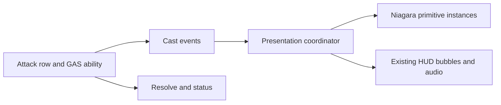

# Attack presentation: Niagara production pipeline

12 November 2026. Production specification for the optional attack expansion.
Read with [the attack pipeline](The_Dread_Land_of_Candy_Attacks_and_Effects_Pipeline.md),
[the effects bible](The_Dread_Land_of_Candy_Attacks_and_VFX_Design.txt), and
[BUILD_SPEC section 3d](BUILD_SPEC.md). BUILD_SPEC governs integration and shipping scope.

## Scope and verified starting point

Deliver in order: this specification; reusable meshes/materials/textures; Niagara
systems and a review scene; gameplay integration when the expansion is selected.
Author the effects as an isolated library under `/Game/FX/Attacks`. Their existence
does not add classes, change combat timing, or commit these attacks to the jam.

Verified in source on 12 November:

- `UJamGameplayAbility` uses LocalOnly execution. `UJamGA_AoeAttack` commits,
  strikes immediately and ends immediately. There are no attack GameplayCues.
- `AJamHero::RequestSkill` starts presentation after successful activation;
  `DrawSkillShape` uses `AJamSkillFx`, a procedural ground mesh. Preserve this fallback.
- The slice has Lecture, Form A Line, Disappointed Sigh and Last Judgment.
  K01/K03 and the other classes are expansion designs, not existing abilities.
- `/Game/FX/M_FxUnlit` exists. No Niagara attack systems existed at inspection.
  NiagaraToolsets is enabled for the editor; a runtime Niagara dependency is still
  required if GAME adds C++ Niagara component calls.
- Hero animation uses single-node clips, including SwordRaise and Sigh, not montages.
  BUILD_SPEC puts expansion timing in attack rows and gameplay-owned timers.
  Do not introduce a competing Niagara hit clock or require montage notifies.
- Imported Celery, Peppermint, Toothbrush and Sword meshes exist under
  `/Game/Art/Meshes/<Name>/StaticMeshes/<Name>`. These are source art, not approved
  particle LODs. New lightweight props below avoid multiplying their render cost.

The newer attack pipeline takes precedence over older effect choreography:
M01 is A Spoonful of Sugar (one hitscan); M03 is Arcane Sanitization;
A02 is ground-targeted celery rain; M02 uses fewer larger peppermint impacts.
Older Sugar Spark, Mouthwash and spread-volley versions remain optional skins.
Text and recorded cries must be sourced through Jokes.md/JamLines; sample slogans
in the reference designs are not permission to add a second dialogue source.

## Deliverables and naming

| Folder | Assets | Purpose |
|---|---|---|
| `Meshes` | `SM_FX_*` | Small reusable cosmetic props; no collision or physics |
| `Materials` | `M_FX_*`, `MI_FX_*` | Particle-color driven surfaces, soft masks, dome, cards |
| `Textures` | `T_FX_*` | Original procedural masks; approved comic artwork later |
| `Systems` | `NS_FX_*` | Shared primitive systems and attack presets |
| `Review` | `L_FX_AttackReview` | Isolated normal-camera inspection scene |

All paths in this document are planned unless listed in the generated asset report.
Record asset existence, compile status and visual review separately. An empty
system, duplicated stock template or successful save is not an approved effect.

The first implementation's delivery record is [the FX handoff](../Workers/fx.md).
**Current implementation status: standalone Niagara prototypes; gameplay
integration and final art approval remain pending.** Stale saved compiled scripts
were repaired by forcing a compile and saving in a fresh process. This repair is
required after generation; an in-memory bytecode audit alone is insufficient.
Generated sources, manifests and rebuild instructions are in
[ImportSource/FX](../../ImportSource/FX/README.md). The recipes below describe the
production target; the delivery record identifies prototype limitations.

The library implements nine shared primitive assemblies and twelve attack
assemblies using **33 single-emitter Niagara systems**. Additional systems use
the `_Layer1` suffix. Load every system listed for an attack in
`ImportSource/FX/attack_presets.json`, using the same transform/seed and owning all
component handles under the cast. Opening just the main `NS_K02_*` asset shows
its primary layer; its review map shows the full assembly. The source JSON is an
authoring manifest, not a cooked runtime registry; GAME must transfer these
references into its presentation table/data assets when enabling the expansion.

## Ownership and event contract

FX owns attack rows and the presentation interface in Combat; GAME owns engine
hookups, assets, dependencies and cooking. This Niagara implementation remains
an isolated asset library until GAME connects that interface. No RPCs,
GameplayCues, new attributes or networked utensil actors are needed for the slice.

Every event carries `CastId`, `AttackId`, `Seed`, origin, normalized forward and
gameplay-resolved dimensions; Contact adds `PulseIndex` and resolved point/normal;
HitResolved adds actual target and outcome. These are ordinary event data, not
necessarily GameplayTags. One cast owns all component handles and audio loops.

| Event | Presentation action |
|---|---|
| Start | Reserve cast record; attach charge; start anticipation |
| Release | Spawn travelling cosmetics or activate stream/orbits |
| Contact | One area accent per gameplay pulse, including a miss; never per prop |
| HitResolved | Target-specific impact/reaction; suppress duplicate area explosions |
| End | Stop emission/loops; allow bounded tails; detach finished travel particles |
| Cancel | Stop emission immediately; remove cards/tethers/dome and stop loops |

Owner destruction, level teardown and interrupted casts use the same cleanup path.
Cancel every layer belonging to the cast. Use native component deactivation or
destruction as the cleanup boundary; shader parameters alone are insufficient
ownership management. The asset review verifies destruction of each layer owner.
Mid-cast `User.Stop` and `User.BudgetOut` updates still need a running gameplay
world test because UE 5.8's component setters defer live parameter writes.
Instant slice abilities finish before `RequestSkill` returns: their cosmetic
one-shots may outlive ability End. Do not cancel a one-shot merely because that
instant ability ended. Sustained expansion abilities need real lifecycle events.

Rain candy/vegetables are decoration. Gameplay owns pulse times, footprints,
snare expiry, moving AoE and projectile contact. Never query particle collisions
to apply Resolve, determine a hit, or clear an objective. Cosmetic travel aimed at
a known contact may use that event's point; it must never fabricate a delayed hit.

## Shared Niagara parameter contract

UE distances are centimetres; +X is forward, +Z is up. Radius is a radius;
cone angle is a half-angle in degrees; strip width is a half-width. Initialize
parameters before activation. Parameters are only required on systems that use them.

| Parameter | Niagara type | Meaning / default |
|---|---|---|
| `User.Radius` | Float | Resolved gameplay radius, default 300 cm |
| `User.Length` | Float | Cone/line length, default 800 cm |
| `User.HalfAngleDeg` | Float | Cone half-angle, default 35 degrees |
| `User.HalfWidth` | Float | Line half-width, default 100 cm |
| `User.TargetPosition` | Position | World-space resolved endpoint; use Position for LWC |
| `User.TargetNormal` | Vector3 | Unit impact normal, default world up |
| `User.PrimaryColor` | Linear Color | Class palette, HDR restrained |
| `User.SecondaryColor` | Linear Color | Accent palette |
| `User.Duration` | Float | Cosmetic active duration from attack row |
| `User.Intensity` | Float | Client density scale, 0..1; never scales footprint |
| `User.PropCount` | Int32 | Absolute capped visible prop count |
| `User.Seed` | Int32 | Stable cosmetic seed selected once per cast |
| `User.Stop` | Bool | Stop emission; existing particles finish bounded lifetime |
| `User.BudgetOut` | Bool | Grey treatment, no emissive glitter; applies to new spawns |

First-pass implementation detail: particle lifetime is baked from each preset's
authored duration, providing a hard cleanup cap. `User.Duration` drives visual
fade; shorten/cancel with `User.Stop`, and regenerate the preset when extending
its lifetime. The initial lifetime test ran while compiled scripts were stale,
so it did not establish a lifetime-binding fault. The generator retains baked
caps; changing this parameter alone does not extend particle lives. A later
coordinator adapter should enforce the cap or validate a dynamic binding.

Ground telegraphs remain world-space and fixed after placement. Cone streams and
orbits follow caster transform; rain remains at the original target. Travel
particles use world space after release. Tether start/end are refreshed from weak
actor references; loss of either endpoint ends the tether.

Use component transform for system origin/facing. Use `SetVariablePosition` for
Position overrides, not Vector3 setters. Pool components only after all parameters,
attachments and seed are reset; a component from another cast must not retain a
target. Verify `UNiagaraComponent` and `UNiagaraFunctionLibrary` signatures in this
installed UE 5.8 source when implementing GAME's adapter.

## Reusable primitive recipes

Use CPU simulation initially for these small bounded mesh counts. GPU flour/foam
is optional after measurement. Every emitter has finite particle lifetimes,
appropriate bounds and an explicit stop condition. No scene-depth collision is
required; bounce against a known cosmetic ground plane if desired.

| System | Emitter stack / renderer recipe | Space and lifecycle |
|---|---|---|
| `NS_FX_Impact` | Burst; initialized color/size/lifetime; outward velocity; drag/gravity; scale/fade; soft sprite plus optional tiny mesh scraps | World; 0.2–0.65 s, generic target impact |
| `NS_FX_LectureCone` | Burst of expanding ring/arc meshes; +X scaled cone envelope; color fade; sparse punctuation/card meshes | Attached origin, direction frozen per one-shot; 0.35–0.75 s |
| `NS_FX_ComicCards` | Burst of 2–6 plane meshes; initial face-camera orientation; mild tumble; alpha fade; assigned pre-rendered card material | World; <=0.8 s; no per-particle widget actors |
| `NS_FX_ProjectileVolley` | Burst of 1–6 prop meshes; seeded fan offsets; interpolate release-to-resolved-end; small trail sprites | World; finite cosmetic travel, no gameplay collision |
| `NS_FX_ProjectileRain` | Burst of capped prop meshes; seeded disc positions; staged cosmetic fall delays; initialized downward speed; plane kill/fade; secondary impact accents cued separately | Fixed target transform; no new damage pulses |
| `NS_FX_OrbitProps` | Burst of pin meshes; position from index angle + elapsed angle, radius/height noise; mesh rotation; flour sprites and sparse motion streaks | Attached; local positions; Stop disables loop, tail <=0.4 s |
| `NS_FX_SoapTorrent` | Spawn rate along +X cone; elongated aqua sprites/stream meshes; white soft foam clusters; bubble sprites; low opacity central corridor | Attached; 0.8–1.2 s active starting point; tail <=0.4 s |
| `NS_FX_ShieldDome` | Single hemisphere mesh particle; soft rim material; 2 heraldic rings; sparse napkin meshes; boundary accent on gameplay event | Attached; status-owned duration; fold/fade <=0.25 s |
| `NS_FX_FlossTether` | Thin strand meshes between two explicit endpoints; glint sprites; short retract on End | World endpoints; no physical rope or particle collision |

For a first pass, use generic ring, impact, prop and stream modules; add secondary
emitters only once silhouette and termination pass. A renderer material must use
Particle Color or explicit bindings; changing an unused User color does nothing.
One-shot burst counts must bind to the chosen density/count, not stay at template defaults.
Fixed bounds must cover full radius/height/travel plus tails, or use verified dynamic
bounds. Check off-camera re-entry and moving casters before marking culling complete.

## Core attack asset specifications

All times below are proposed presentation recipes. Contact is always supplied by
gameplay. Existing Lecture hits immediately: the 0.8 s sword fakeout requires an
explicit gameplay timing change in the expansion, not an unnoticed VFX delay.

| ID / preset | Niagara assembly | Distinguishing read | Contact and finish |
|---|---|---|---|
| K01 `NS_K01_PoliteShield` | Small blue/gold arc + compact Impact | Formal shield push; small neat paper flecks | Single contact; <=0.35 s tail |
| K02 `NS_K02_SternInstruction` | Charge glint, LectureCone, formal ComicCards | Sword rises, pauses, points; NO blade slash | One cone accent at contact; scraps fade <=0.6 s |
| K03 `NS_K03_GoodManners` | ShieldDome + heraldic rings + sparse napkins | Transparent center, gold edge; tiny HUD rebukes | Initial pulse then actual boundary events; remove on status end |
| B01 `NS_B01_FuriousKneading` | Cream Impact + flour + small dough meshes | Squashy low puff; repeatable without opaque dust | One contact; 0.3–0.5 s |
| B02 `NS_B02_RollingPinCyclone` | OrbitProps + flour + orbit streaks | 2 pins build to many-looking vortex; clear center | Accent per gameplay pulse; final starburst only on normal finish |
| B03 `NS_B03_AggressiveEncouragement` | Warm LectureCone + chaotic ComicCards | Orange/red jagged cards; explosive parental shout | One cone contact; exhaustion variant changes voice, not hit timing |
| M01 `NS_M01_SpoonfulOfSugar` | 5–6 small cube ProjectileVolley + sugar Impact | White/gold miniature fan converges on one point | ONE hitscan; all cubes cosmetic; 0.25–0.4 s |
| M02 `NS_M02_PeppermintPopfall` | Red/white ring + sparse heavy ProjectileRain + Impact | Large striped candy; slower rhythm; large final pop | Gameplay pulse accents; <=12 candy meshes at High |
| M03 `NS_M03_ArcaneSanitization` | Aqua SoapTorrent + foam/bubbles + clean Impact | Apocalyptic hygiene stream; recognizably white foam | Gameplay cone pulses; interruption stops all stream emission |
| A01 `NS_A01_CeleryShot` | One celery prop travel + green Impact | Single stalk silhouette; brief leaf crunch | Actual trace/projectile result, not leaf collision |
| A02 `NS_A02_CeleryVolley` | Green ring + denser ProjectileRain + leaf Impact | Celery forest, many lighter impacts; one late cosmetic stalk | Area pulses from gameplay; late stalk never applies Resolve |
| A03 `NS_A03_FlossSnare` | Travel glint + FlossTether/web + endpoint sparkles | Brilliant thin white geometry; purposeful few strands | One hit/status application; web ends at status expiry |

K02 and B03 share cone/card machinery but different palettes, alignment and density.
M02 and A02 share rain machinery but different prop scale, spacing and rhythms.
K01/K03 should not resemble offensive sword slashes. Keep nonviolent reactions in
the existing target animation/HUD layer, including Pacified and Flustered.

## Supporting asset build list

Build cheap original geometric assets first; reuse approved source art only where
it is readable and affordable. All particle meshes: centimetres, predictable pivot,
one material slot, no collision, no Nanite requirement. Triangle counts are ceilings.

| Asset | Specification | Consumers |
|---|---|---|
| `SM_FX_Ring` / `SM_FX_Arc` | Flat XY annulus / 70-degree arc, outer unit radius 100 cm; <=128 tris, UV across band | Cone, pulse, telegraph |
| `SM_FX_Pin` | Rounded wooden cylinder + handles, +X long axis, centered pivot; <=400 tris, ~60 cm long | B02 |
| `SM_FX_SugarCube` | Beveled-looking cube, centered, 10 cm side; <=96 tris | M01 |
| `SM_FX_Peppermint` | Thin round candy, face normal +X, radial red/white sectors; <=192 tris, 35 cm diameter | M02 |
| `SM_FX_Celery` | Tapered stalk + 2–3 simple leaf lobes, +X tip, centered; <=192 tris, 65 cm long | A01/A02 |
| `SM_FX_Card` / `SM_FX_Napkin` | Single two-sided plane, 40 cm wide; readable UVs, centered | B03/K02/K03 |
| `SM_FX_Dome` | Upper hemisphere, radius 100 cm, pivot at floor center; <=512 tris | K03 |
| `SM_FX_Strand` | Narrow +X strip, length 100 cm, pivot at start; <=12 tris | A03 |
| `T_FX_SoftDisc` | 128² grayscale radial soft alpha, smooth zero edge | Foam, flour, impact |
| `T_FX_Bubble` | 128² ring alpha with sparse highlight, transparent center | Soap bubbles |
| `T_FX_Star` | 128² four-point sparkle alpha | Sugar, clean glints |
| Comic artwork | 512²–1024² transparent, padding, approved typography; readable at gameplay camera | K02/B03, later imported delivery |
| `M_FX_Particle` | Unlit translucent; particle color x soft mask; alpha fade; restrained emissive | Sprites |
| `M_FX_Mesh` | Opaque/masked particle-color tint, vertex color detail | Props |
| `M_FX_Rim` | Translucent low-opacity surface, soft rim, no refraction in jam tier | Dome/rings |
| `M_FX_Card` | Two-sided alpha artwork x particle color; no runtime text layout | Cards/napkins |

Geometric placeholders are valid for system assembly, but plain cards do not
satisfy the multilingual artwork requirement. Voice clips, dispensing-hand poses,
reaction clips and sound effects remain separate deliveries. Do not claim them
generated by a Niagara asset build.

## Quality, pooling and packaging

Starting **per visible cast** budgets, to be measured rather than treated as frame guarantees:

| Primitive | Low | Medium | High |
|---|---:|---:|---:|
| Cyclone 3D pins | 4 | 8 | 20 |
| Peppermint 3D candy | 3 | 6 | 12 |
| Celery rain 3D stalks | 5 | 10 | 16 |
| Comic cards | 2 | 4 | 6 |
| Foam/flour live sprites | 24 | 64 | 128 |
| Decorative tether strands | 2 | 4 | 6 |

Owner defaults to Medium. Future teammate effects reduce secondary density; essential
area and directional cues retain full dimensions and event timing. Low disables
camera effects, long tails and extra flour, not telegraphs. A presentation cap may
drop debris before signatures. Add a Niagara Effect Type with distance/significance
culling after review; never hide an essential gameplay warning through that cap.

Prefer pooled one-shots; retained stream/dome/tether components need cast-owned
handles. Stop looping spawn on End, then release after completion; Cancel removes
residual geometry immediately where necessary. Clear callbacks before pooling.
Always support null spawn return and missing assets by retaining the T19 fallback.

GAME adds the runtime Niagara module dependency when binding components. Use hard
references through a cooked preset registry or explicitly cook `/Game/FX/Attacks`
for path-based loads. Keep the review map out of the default flow. `-noart` and
budget-out must apply to later-spawned particles as well as existing mesh actors;
material parameters/user variables handle Niagara's own renderers.

## Build and acceptance sequence

1. Build masks, materials and low-poly props; validate mesh counts, UVs, pivots,
   alpha edges and particle material usage. Save a generated manifest.
2. Author one generic impact and LectureCone; derive K02/B03. Review at the actual
   1700 cm camera arm, 50-degree pitch and FOV 55 before adding expensive layers.
3. Author ProjectileRain once; derive M02/A02 and prove they read differently.
4. Author pins/flour and soap/foam, then dome/tether and basic attacks.
5. Compile every system, reload saved assets, record errors and inspect screenshots
   of each preset in an isolated review map. No stock-template placeholders marked final.
6. GAME connects successful-cast and hit events, then expansion lifecycle events.
   Preserve instant slice behavior; do not add windup without moving gameplay contact.
7. Run `Jam.*`, title-to-title autoplay, T19 screenshot comparison, cook/package and
   smoke test once runtime integration occurs. Asset-only work gets compile, load,
   visual and cook checks; a source build alone does not validate particles.

Review matrix: each preset hit and miss; cancel during charge/active/tail; recast
with another seed and target; caster/target destruction; offscreen and return;
several overlapping casters in the review map; Low/Medium/High; budget-out before
and during cast; `-noart`; packaged load. Actual multiplayer testing belongs to
the later multiplayer implementation, which does not exist today.

Jam cuts: preserve the current ground flashes first; then ship cone + impact;
then rain; then one pin/foam showcase. Drop extra cards, high-density flour,
dome/web polish and catch/late-prop gags before risking slice reliability.
All incomplete expansion content stays out of the shipping flow by day 3.
